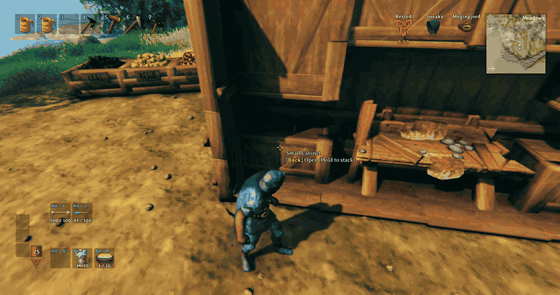
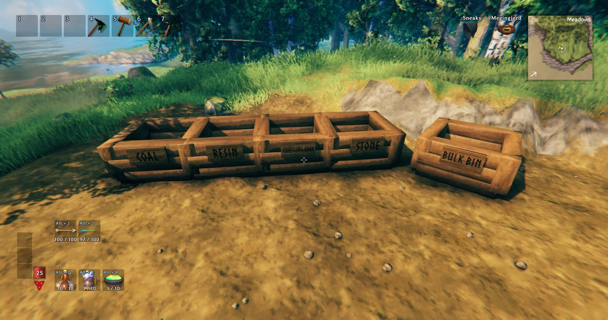
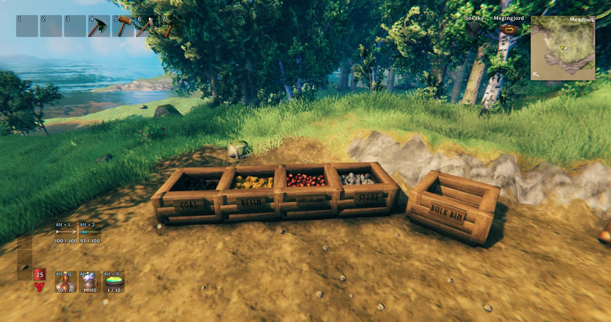
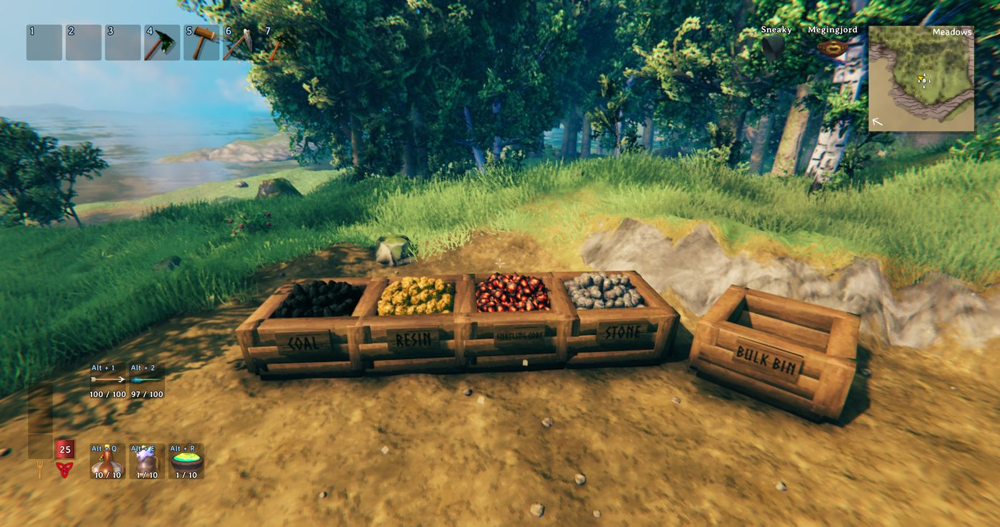
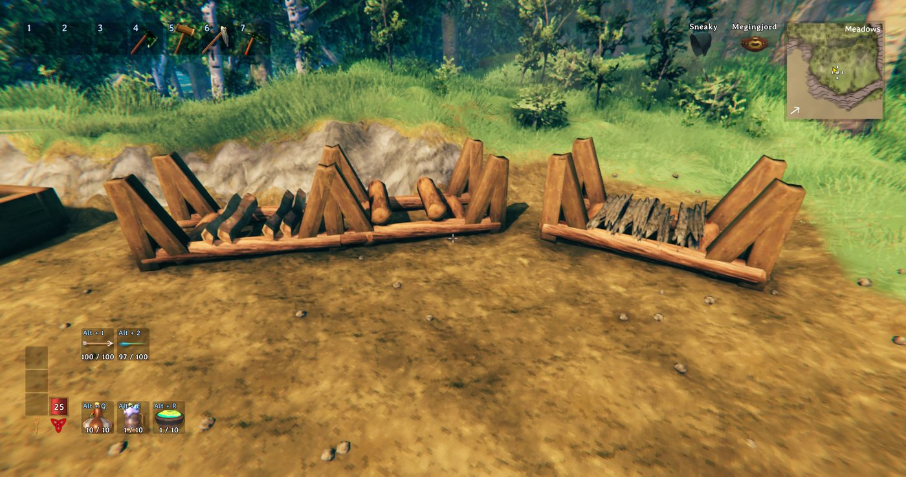
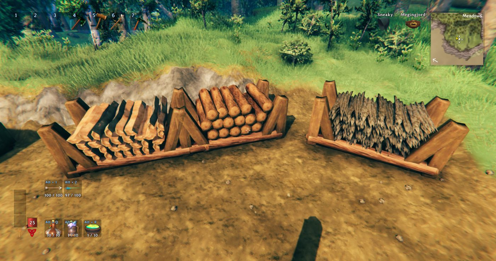
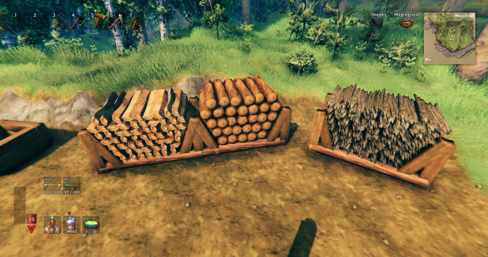
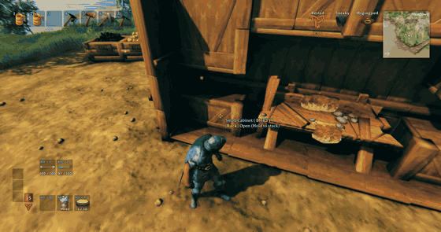
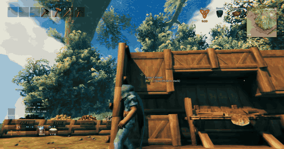

# Enigma's Shelf Life

*Bins that fill up, racks that stack, and cabinets that show what is on their shelves.*

Storage that shows what is inside. Bulk bins and a woodpile rack for stone, ore, scrap and wood that fill up as you load them, and display cabinets with doors, where every shelf shows the item in its slot. Furniture comes next, and this mod is where it will grow. Everyone on a server needs the mod.

## What it looks like

### Bulk Storage Bin

Empty, half full and full. The bin fills with pieces of whatever you put in, and the sign shows what it holds.

  

### Woodpile Rack

The same idea for wood and logs, stacked in the rack's V.

  

### Cabinets: putting things in

The window matches the shelves. Drag an item in and it appears on its shelf. Something a shelf cannot show is refused with a short message.

### Cabinets: taking things out

Take an item and its shelf goes empty again. Stacks work like any vanilla container.

## Features

- **Bulk Storage Bin:** an 8 x 4 window for one kind of stone, ore, scrap, bone, resin or fuel at a time. The bin fills with pieces of that material as you add it, a sign shows what is inside, and the pile is solid, so nobody stands inside it. Aim at the material and press Use to open it, not only at the frame.
- **Woodpile Rack:** the same for wood and logs, stacked in the rack. The hover text shows which wood it holds.
- **Small Cabinet (4 x 2 slots) and Large Cabinet (4 x 4 slots):** the window matches the shelves, and each shelf shows the item in its slot. Stacks work like any vanilla container, and a shelf shows one item of its stack.
- **Doors:** the cabinet doors open when you open the window and close when you close it.
- **Snapping:** cabinets snap to each other on the sides, top, bottom and back. The front stays free, so you cannot build one in front of another.
- **Tidy building:** the space above a bin or rack is kept free of building pieces so the pile does not poke through floors.
- **Where to find them:** Hammer > Storage.

## More to come

Shelf Life is the home for furniture that holds and shows things. More pieces, such as tables, seating and other furniture with slots, are planned and will arrive as updates to this same mod, so your saved pieces and settings stay put.

## How it works

Open a bin or cabinet with Use, like any chest. A bin or rack takes one kind of material at a time and refuses the rest with a short message. A cabinet slot accepts whatever a vanilla item stand can show (weapons, armor, food, tools and so on). You can add other mods' items to a cabinet, or block items you do not want in one, in the settings.

## Download

Install from Thunderstore with r2modman or the Thunderstore app. Dependencies are installed automatically:

[https://thunderstore.io/c/valheim/p/Enigma_Prime/Enigmas_Shelf_Life/](https://thunderstore.io/c/valheim/p/Enigma_Prime/Enigmas_Shelf_Life/)

To change settings in game, install Configuration Manager and press F1.

## Settings

Settings are in `BepInEx/config/EnigmaPrime.EnigmasShelfLife.cfg` after the first run. The main groups:

- **Bulk bin:** extra prefab names the bin accepts.
- **Cabinets:** extra items a cabinet accepts, and blocked items it refuses.
- **Bulk bin fill display and Woodpile rack fill display:** how the pile looks (size, spacing, layers, mound).
- **No-build space:** how much space above a bin or rack is kept free.

The item lists are synced from the server in multiplayer. Item names are the game's prefab names, separated by commas.

## Multiplayer and servers

Everyone on the server needs the mod, on the same version, and the server needs it too.

## Compatibility

- Needs Balrond Constructions (the cabinets use some of its trim pieces).
- The bin and cabinet checks run before other mods that change what goes into containers, so the rules always hold.

## Performance

Far away bins and racks (more than 70 m) draw nothing. If a base with many bins costs frame rate, lower "Visible layers" in the fill display settings.

## Known issues

- The mod uses the game's normal Use button for everything, with no new keys, so a controller works the same way. Controller support is built in but untested, please report problems.

## Support

If you like the mod and want to say thanks, you can: [buy me a coffee on Ko-fi](https://ko-fi.com/enigmaprime)

 

Bug reports and ideas are just as welcome. Open an issue on [GitHub](https://github.com/relinkem/Enigmas-Shelf-Life/issues) and include your BepInEx log (`LogOutput.log`) and, if it is a settings problem, your config file. Ideas and suggestions are also welcome in the comments on my [Ko-fi page](https://ko-fi.com/enigmaprime).

## More mods by Enigma Prime

**[Enigma's Realistic Smoke Rework](https://thunderstore.io/c/valheim/p/Enigma_Prime/Enigmas_Realistic_Smoke_Rework/)** Smoke that rises, pools and bends in the wind, with flames that follow their fuel.

 

**[Enigma's Item Salvager](https://thunderstore.io/c/valheim/p/Enigma_Prime/Enigmas_Item_Salvager/)** Take your gear apart at the Workbench, Forge, Black Forge or Galdr Table and get some of the materials back.

 

**[Enigma's Useful Tasty Mead](https://thunderstore.io/c/valheim/p/Enigma_Prime/Enigmas_Useful_Tasty_Mead/)** A sweet mead that makes your food count as freshly eaten again, lifting your max health, stamina and Eitr before fading back.

 

**[Enigma's Enhanced Forging](https://thunderstore.io/c/valheim/p/Enigma_Prime/Enigmas_Enhanced_Forging/)** Smelters, kilns and the Eitr refinery become walk-away machines with inventory screens, a Light button and winding animations.

 

**[Enigma's Tidy Cart](https://thunderstore.io/c/valheim/p/Enigma_Prime/Enigmas_Tidy_Cart/)** Back your empty cart up to a wall and stow it upright out of the way, with your character playing it out.

 

**[Enigma's Snug Fit](https://thunderstore.io/c/valheim/p/Enigma_Prime/Enigmas_Snug_Fit/)** Spin, tilt and nudge building pieces in small steps while you place them, and snap a piece's middle onto another.

 

## How this mod was made

The ideas, the design, and every decision about how Shelf Life should work are mine: bins that show how full they are, a woodpile rack, and cabinets whose shelves show what is in them. However, I am not a programmer. The code was written by Claude, an AI assistant made by Anthropic, working from my direction through [Claude Code](https://claude.com/claude-code).

I want to be upfront about that. I am the one who plays the game, so I test every build in Valheim, read the game log for errors, and send back anything that looks or feels wrong until it behaves the way I intended. The code was also checked against Valheim's own code so it hooks in the right places. If you find a bug, please open an issue and I will work on a fix.

The cabinet frame includes build pieces from BalrondConstructions by Balrond (https://thunderstore.io/c/valheim/p/Balrond/balrond_constructions/). Used with the author's permission.

Not affiliated with or endorsed by Anthropic.

## Changelog

See [CHANGELOG.md](https://github.com/relinkem/Enigmas-Shelf-Life/blob/main/Release/CHANGELOG.md).

## License

All rights reserved. You are free to download and use the mod, but please don't redistribute, modify or re-upload it without asking first, see [LICENSE](https://github.com/relinkem/Enigmas-Shelf-Life/blob/main/Release/LICENSE). Valheim is the property of Iron Gate AB and Coffee Stain Publishing. This mod is not affiliated with or endorsed by them.
